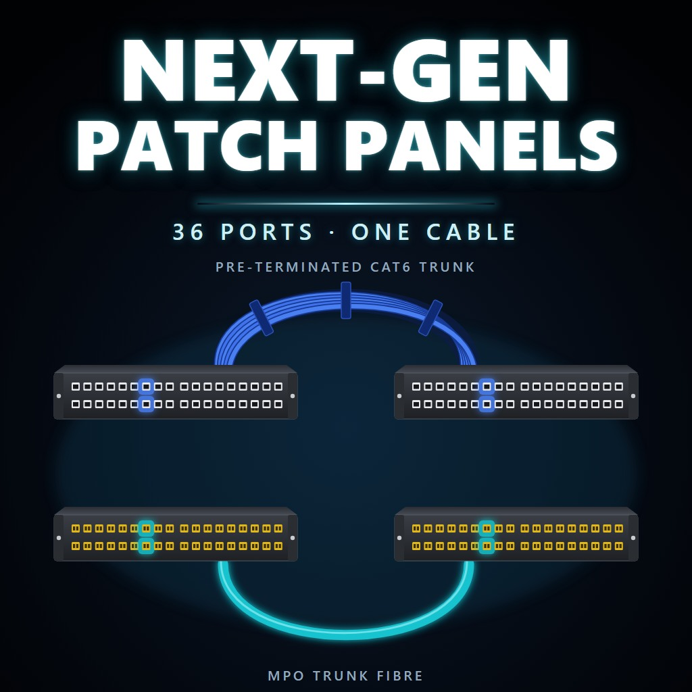
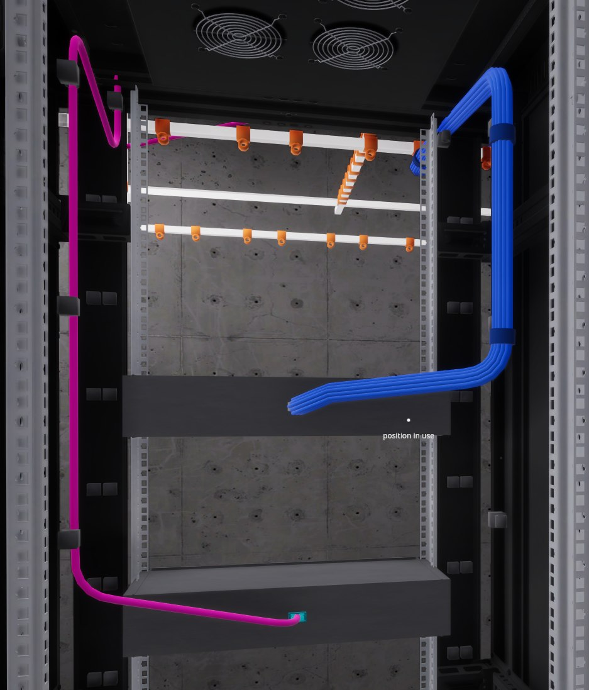
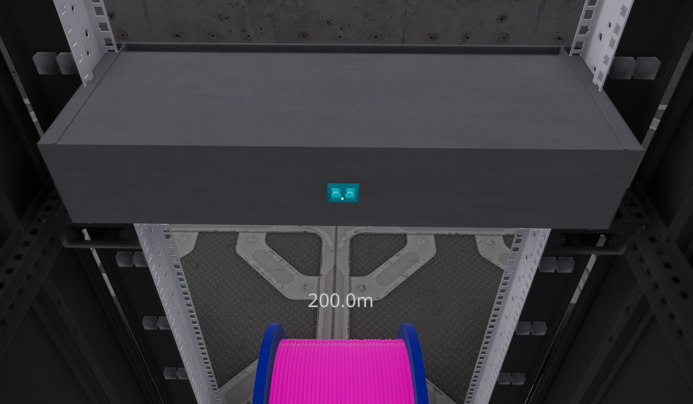
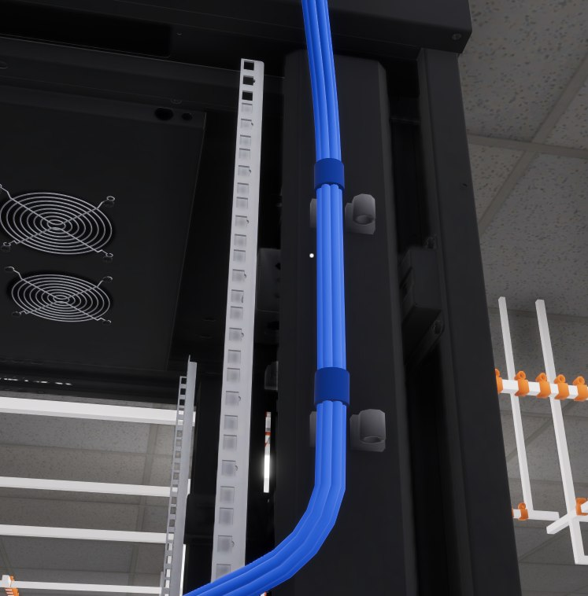

# Next-Gen Patch Panels

A mod for **Data Center** (by Waseku) that links a patch panel in one rack to a patch panel in another with **one trunk cable** instead of 36. Real data centres do exactly this, with MPO trunks and pre-terminated copper trunks.

[Download from GitHub Releases](https://github.com/checkersx/data-center-next-gen-patch-panels/releases)



**Contents:** [What you get](#what-you-get) · [How to use it](#how-to-use-it) · [Prices](#prices) · [Before you install](#before-you-install) · [Install](#install) · [Settings](#settings) · [Saves](#saves) · [Can't pick a trunk port or holder?](#cant-pick-a-trunk-port-or-holder) · [Compatibility](#compatibility) · [How it works](#how-it-works) · [Building from source](#building-from-source)

---

## What you get

- **Trunk Patch Panels**, copper and fibre, in the shop below the patch panels. 2U, **36 ports** on the front, and a closed box at the back with **one trunk port**.
- **Two trunk cables**, in the shop below the cables:
  - **Pre-terminated Cat6 Trunk** for copper panels: a strapped bundle of cables.
  - **MPO Trunk Fibre** for fibre panels: one thick aqua cable.
- **Cable holders inside every rack**, down both side walls, so you can route a trunk up and out of the rack neatly.



## How to use it

1. Rack a Trunk Patch Panel in each of two racks: copper with copper, or fibre with fibre.
2. Hold the matching trunk cable, click the trunk port on the back of one panel, route the cable over the holders and ceiling trays, and click the trunk port on the other panel. The game says **"Trunk linked: 36 ports"**.
3. Port 1 on one panel now reaches port 1 on the other, and so on up to port 36. Cable your servers and switches into the ports as usual.

Take the trunk cable out and the panels unlink ("Trunk unlinked"). Put it back and they link again.

- Trunk ports only take the matching trunk cable, and trunk cables only plug into trunk ports. They hang on any cable holder.
- Trunk panels never slow a link down: each link runs at the speed of the cables plugged in at either end.
- A trunk panel can't be taken out of its rack while its trunk cable is attached.

| The trunk port, on the back of a fibre trunk panel | A Pre-terminated Cat6 Trunk on the rack's holders |
|---|---|
|  |  |

## Prices

- Trunk Patch Panels cost twice the matching vanilla panel: copper $500, fibre $900 and 1,000 XP.
- A trunk cable replaces 36 cables, so it costs 36 spools: Pre-terminated Cat6 Trunk $18,000 (36 copper spools), MPO Trunk Fibre $108,000 (36 QSFP fibre spools) and 1,600 XP.

---

## Before you install

You need these once, for any code mod in Data Center. If you already use other code mods, you most likely have them.

1. **MelonLoader 0.7.3** from the [MelonLoader releases page](https://github.com/LavaGang/MelonLoader/releases). Run the installer, point it at `Data Center.exe`, choose **0.7.3** and install. Start the game once, then quit.
2. **A fix-up plugin**, or no code mods load at all: [DS-InteropFix](https://steamcommunity.com/sharedfiles/filedetails/?id=3797166996) (Steam Workshop) or [Il2CppAssemblyFixer](https://github.com/mleem97/Il2CppAssemblyFixer) (GitHub). Follow its own instructions.

## Install

There's one file: **`NextGenPatchPanels.dll`**. It goes in the **`Mods`** folder inside your game folder. To open the game folder: in your Steam Library, right-click **Data Center** → **Manage** → **Browse local files**. Use the `Mods` folder next to `Data Center.exe`, not the one inside `StreamingAssets`.

- **From GitHub:** download `NextGenPatchPanels.dll` from the [Releases page](https://github.com/checkersx/data-center-next-gen-patch-panels/releases), put it in `Mods`, and start the game.
- **From the Steam Workshop:** subscribe to the mod. If you have [WorkshopModSync](https://steamcommunity.com/sharedfiles/filedetails/?id=3830456292), that's all: start the game. Without it, start the game once and quit, then open `Data Center_Data` → `StreamingAssets` → `Mods` in your game folder, type `NextGenPatchPanels.dll` into File Explorer's search box, and copy the file it finds into your game's `Mods` folder.

**Check it worked:** the MelonLoader console shows `Next-Gen Patch Panels v1.0.0`, and the shop has Trunk Patch Panels and trunk cables.

**WorkshopModSync** is a free helper by Bloody that copies your subscribed Workshop code mods into the right folders every time the game starts. Set it up once from [its Workshop page](https://steamcommunity.com/sharedfiles/filedetails/?id=3830456292), which has a one-click installer. You have it if your game folder's `Plugins` folder contains `WorkshopModSync.dll`.

**Updating:** with the game closed, replace `NextGenPatchPanels.dll` with the new one (WorkshopModSync does this for you).
**Uninstalling:** with the game closed, unsubscribe on the Workshop first (so WorkshopModSync doesn't put it back), then delete `NextGenPatchPanels.dll` from `Mods`.

## Settings

In `UserData\MelonPreferences.cfg` in your game folder (it appears after the first run with the mod), under `[NextGenPatchPanels]`. Edit it with the game closed.

| Setting | Default | What it does |
|---|---|---|
| `PortSpeed` | `10000` | Speed of a trunk panel's ports, in the game's units (2 = 10 Gbps). The default means trunk panels never slow a link down. |
| `RackMountPoints` | `true` | Cable holders down the inside walls of every rack. Set to `false` to leave racks as they are. |
| `HideRackSlotsWhileCabling` | `true` | While you hold a cable, rack slots don't get in the way of picking holders and trunk ports inside a rack. |

## Saves

- Saves stay vanilla. Trunk panels are saved as normal patch panels, and a small `<save>.nextgenpatchpanels.json` file next to the save remembers which ones are trunk panels. A link is just the trunk cable, saved like any other cable.
- Remove the mod and your saves still load: trunk panels become normal patch panels, trunk cables are dropped, and trunk cable spools left lying around disappear. Back up your save first.

## Can't pick a trunk port or holder?

Hold the cable, aim at it and press **F8**. The MelonLoader log (`Data Center\MelonLoader\Latest.log`) lists everything your aim passes through, nearest first, and marks the one the game picks. Please open an [issue](https://github.com/checkersx/data-center-next-gen-patch-panels/issues) with that log.

## Compatibility

- Standalone: no gregCore or other framework needed.
- Works alongside [Next-Gen Hardware](https://github.com/checkersx/data-centre-next-gen-hardware), [Firewall Fix](https://github.com/checkersx/data-center-firewall-fix) and MoreSpools. The trunk cable spools use spool IDs 900 and 901, clear of MoreSpools' 100–147.
- **Co-op has never been tested.** It should work in theory, as long as every player has the mod at the same version.
- Rack templates (designer room) with trunk panels haven't been tested.
- Tested on Steam build 25869593 of Data Center, with MelonLoader 0.7.3.
- Not affiliated with Waseku.

---

## How it works

For anyone curious, or for building on it.

- **Vanilla patch panels.** A panel has 36 ports in two rows, and port *i* in the top row is paired with port *i* in the bottom row: `PatchPanel.InsertedInRack` gives both the same `switchID`, `"<panelId>_<i>"`. Every cable end is named after its port's ID, and the network graph (`NetworkMap`: routing, VLANs, firewalls, malware) joins cables whose ends share a name. So a cable into one port of a pair meets a cable into the other.
- **Trunk panels** are copies of the vanilla copper and fibre panels, added to `MainGameManager.patchPanelsPrefabs`. Each of the 36 ports gets its own ID, `"<panelId>_1"` to `"_36"`. The trunk port, `"<panelId>_MPO"`, is kept out of vanilla's pairing.
- **Linking.** A cable whose two ends are trunk ports (a postfix on `NetworkMap.RegisterCableConnection`) links the two panels. The panel with the smaller ID keeps its port IDs, and the other panel's port *k* takes its port-*k* ID. Cables on port *k* of either panel then meet at one node, exactly as across a vanilla pair. Cables already plugged into the other panel are renamed: `WaypointInitializationSystem.UpdateCableInfo`, then `NetworkMap.RemoveCableConnection` and `RegisterCableInNetworkMap`. Removing the trunk cable (`RemoveCableConnection`) renames them back, and each cable end's position decides which panel it's on.
- **Saving.** During `SaveSystem.SaveGame`, trunk panels report the vanilla panel type and are listed in the sidecar file, which `LoadGame` maps back before anything spawns. The trunk cable needs nothing extra: when it's loaded and registered again, the panels link again.
- **Trunk cables** are copies of the vanilla copper and fibre spools in `MainGameManager.cableSpinnerPrefab`, at 900 and 901. A prefix on `CableLink.InteractOnClick` enforces which cable goes where. Their look comes from a prefix and postfix on `CablePositions.RedrawCable`: the MPO trunk is a wider tube, and the Cat6 trunk is 19 tubes along parallel-transported offsets of the cable's path, with a strap at each bend point the player clicked.
- **Rack holders.** The game's cable holders are `CableLink`s that aren't cable ends. Racks come from `MainGameManager.rackPrefab`, which is swapped for a copy that has extra holders, placed in front of the side walls' colliders.
- **Picking things.** `RayLookAt.HandleLookAtRay` picks the first collider its ray hits. Rack slots (`RackPosition`) have colliders even when full, so while a cable spool is in hand they go on the "Ignore Raycast" layer.

## Building from source

You need the .NET SDK (6 or later) and the game with MelonLoader installed (start the game once so MelonLoader generates its files).

```
dotnet build -c Release src/NextGenPatchPanels
```

The build looks for the game at `G:\SteamLibrary\steamapps\common\Data Center`. If yours is somewhere else, add `-p:GameDir="<your game folder>"`. The built DLL is copied straight into the game's `Mods` folder (add `-p:Deploy=false` to skip that). Close the game first, because the game locks the DLL while it's running.

`workshop\build-package.ps1` builds the Steam Workshop upload into `publish\`.

## Licence

[GNU General Public License v3.0](LICENSE).
